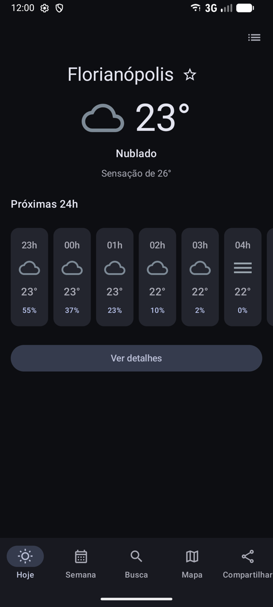
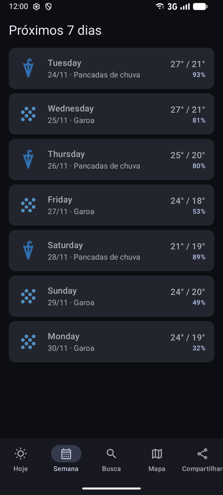
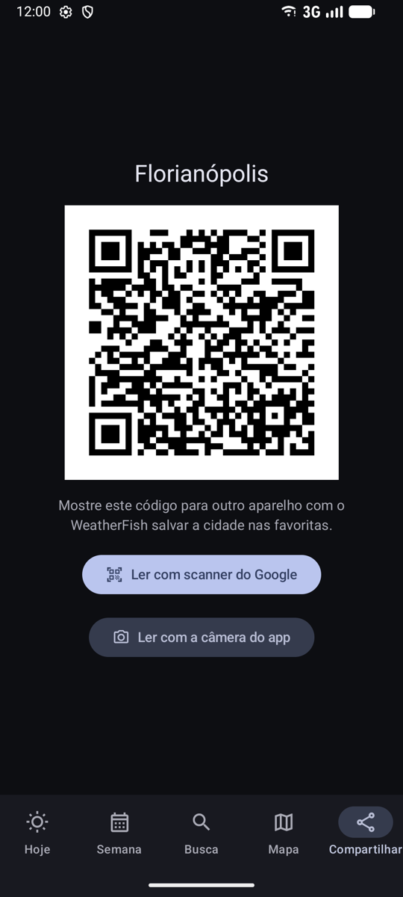

# WeatherFish

O WeatherFish é um app Android de previsão do tempo, feito para estudo em Kotlin e Jetpack Compose. Ele abre com o clima do local do aparelho e mostra a condição atual, as próximas 24 horas e os próximos 7 dias. A busca e as favoritas trocam a cidade. Os dados vêm do [Open-Meteo](https://open-meteo.com/). O app também tem adapters para a [Xweather](https://www.xweather.com/), pelo SDK Aeris e por REST, e um fake com JSONs fixos.

|                                                            Hoje                                                             |                                                Semana                                                 |                                                        Compartilhar                                                        |
|:---------------------------------------------------------------------------------------------------------------------------:|:-----------------------------------------------------------------------------------------------------:|:--------------------------------------------------------------------------------------------------------------------------:|
|  |  |  |

## Funcionalidades

O app tem cinco abas:

- **Hoje** mostra a condição atual e a previsão por hora, com acesso aos detalhes e às favoritas.
- **Semana** mostra a previsão diária dos próximos 7 dias.
- **Busca** encontra cidades. Tocar num resultado troca a cidade ativa, e a estrela favorita a cidade.
- **Compartilhar** mostra um QR da cidade ativa. Dois botões leem o QR de outro aparelho e salvam a cidade nas favoritas. "Ler com scanner do Google" abre a tela pronta do Google. "Ler com a câmera do app" abre a câmera dentro do WeatherFish.
- **Mapa** mostra um mapa Mapbox centralizado na cidade ativa, com as camadas de temperatura e de vento do MapsGL, da Xweather.

Toda tela abre por um deep link `weatherfish://`, como `weatherfish://week`. A lista completa está em [Arquitetura](docs/architecture.md). Ler o QR da Compartilhar com a câmera nativa do celular abre o WeatherFish e pergunta se você quer salvar a cidade.

A tela **Favoritas** abre pela Hoje. Ela lista as cidades salvas, tem um atalho para a localização atual e troca a unidade entre °C e °F.

O app segue MVVM e tem um único módulo Gradle. Ele usa Hilt, coroutines com Flow, DataStore e Navigation Compose. O app gera o QR com o ZXing core. Ele lê o QR de dois jeitos: com o Google code scanner, que não pede permissão de câmera ao app, ou com CameraX e ML Kit, que pedem.

## Como executar

### Requisitos

Prepare o ambiente antes do primeiro build:

- Instale o Android Studio, ou só o Android SDK com a plataforma `android-37`.
- Use um aparelho ou emulador com Android 15 ou mais novo.
- Instale o JDK 25, ou deixe o Gradle baixar esse JDK no primeiro build.

### Chaves

Copie o `local.properties.example` para `local.properties` e preencha as chaves:

- `XWEATHER_CLIENT_ID` e `XWEATHER_CLIENT_SECRET` ficam em **Access Keys**, no painel da Xweather.
- `MAPBOX_ACCESS_TOKEN` é o token público do Mapbox, que começa com `pk.`.

O `.gitignore` exclui o `local.properties`. Sem as chaves, o build passa. O Open-Meteo não pede chave, então as telas de clima funcionam. O Mapa mostra uma mensagem no lugar das camadas.

O `dataSource()` de `app/src/main/java/dev/rogerbertan/weatherfish/di/DataModule.kt` escolhe a fonte dos dados: `DataSource.OpenMeteo`, `XweatherSdk`, `XweatherRest` ou `Fake`. O fake lê os JSONs de `app/src/main/assets/fake/`.

### Comandos

Rode os comandos na raiz do projeto:

```bash
./gradlew installDebug                   # instala no aparelho ou emulador conectado
./gradlew test                           # testes unitários
./gradlew lint                           # Android Lint
```

Para abrir uma tela direto pelo deep link, rode `adb shell am start -a android.intent.action.VIEW -d "weatherfish://week" dev.rogerbertan.weatherfish`.

Na primeira abertura, o app pede a localização aproximada. Se você negar, ele abre na última cidade salva. Sem cidade salva, ele abre em São Paulo.

## Documentação

A pasta `docs/` tem o resto da documentação:

- [Arquitetura](docs/architecture.md) explica as camadas, a cidade ativa, o cache e as preferências.
- [Spike do SDK Aeris](docs/aeris-spike.md) registra as respostas da API Xweather e o comportamento do SDK.
- [Antes e depois do Aeris](docs/aeris-comparison.md) mede o impacto do SDK no APK, no manifest e nas dependências.
- [Antes e depois do QR](docs/qr-comparison.md) mede o impacto do ZXing e do scanner do Google, e registra o que o scanner devolve em cada caso.
- [Fase 4 contra Fase 5](docs/qr-camera-comparison.md) compara o scanner do Google com a câmera do app em linhas, permissões, APK, lifecycle e customização.
- [Spike do MapsGL](docs/mapsgl-spike.md) registra como o MapsGL funciona com Compose e os problemas do SDK.
- [Antes e depois do MapsGL](docs/mapsgl-comparison.md) mede o impacto do Mapbox e do MapsGL no APK, no manifest e nas dependências.
- [Adapters REST](docs/rest-comparison.md) compara o SDK Aeris com o REST da Xweather e com o Open-Meteo.
- [Endurecimento do release](docs/hardening.md) registra o smoke test do release, os estados de erro, o `client_secret` no APK, o manifest e o tamanho finais, as respostas do discovery e as conclusões do estudo.