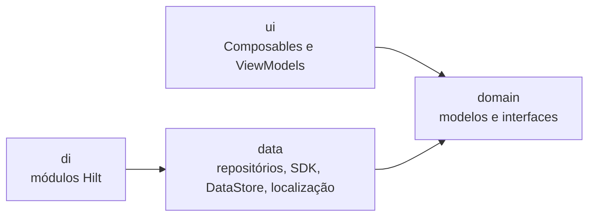
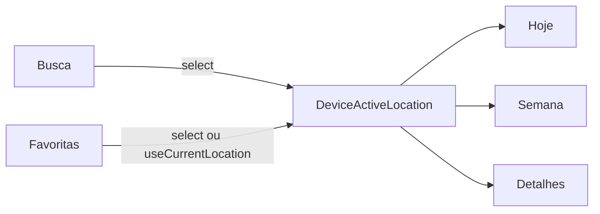
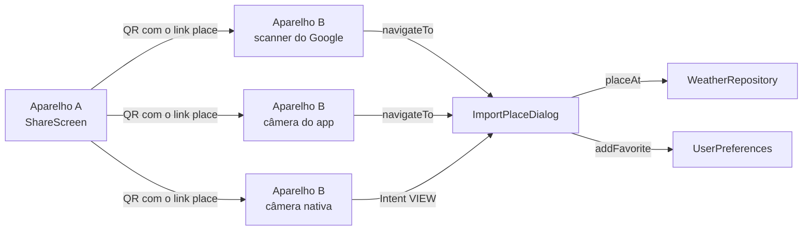

# Arquitetura

O WeatherFish tem um único módulo Gradle, o `:app`, por escolha do projeto. As camadas são pacotes dentro de `dev.rogerbertan.weatherfish`. Sem módulos separados, o compilador não impede que uma camada importe outra. O `ArchitectureTest` faz esse papel e falha quando uma camada importa um pacote que ela não pode usar.

## As camadas são pacotes

O diagrama mostra quem depende de quem:

- `domain` tem os modelos, como `Place`, `CurrentWeather` e `TemperatureUnit`. Também tem as interfaces `WeatherRepository`, `ActiveLocation` e `UserPreferences`. Não importa nada de Android.
- `data` implementa as interfaces. É o único pacote que importa o SDK Aeris, o Play Services e o DataStore.
- `ui` tem um pacote por tela e depende só de `domain`.
- `di` liga cada interface à implementação.

O repositório devolve os dados direto e lança uma `WeatherError` quando falha, como um service do Spring. O projeto não usa tipos de resultado como `Result`. A UI captura a `WeatherError` só no helper `loadState`. Em seguida, a interface exibe o aviso de erro junto à opção de realizar uma nova tentativa.

## Uma única cidade ativa para todas as telas

A `DeviceActiveLocation` é o único lugar que guarda a cidade ativa. Ela expõe a cidade como um flow, e os ViewModels de Hoje, Semana e Detalhes coletam esse flow. A Busca e as Favoritas só chamam `select`.

Nenhuma tela guarda uma cópia da cidade, então as três telas nunca mostram cidades diferentes. Quando a cidade muda, as três recarregam, mesmo as que não estão visíveis.

Na primeira coleta, a `DeviceActiveLocation` emite na hora a última cidade salva no DataStore, ou São Paulo se não houver nenhuma. Ao mesmo tempo, ela busca a localização do aparelho, e a Xweather converte essa localização em cidade. Quando a resposta chega, a cidade ativa passa a ser a local.

A busca de localização pode levar até 10 s de GPS, mais um request. Com a cidade salva emitida primeiro, a Hoje já mostra o clima durante esse tempo. Na barra do topo, ela mostra "Buscando sua localização". Se o usuário escolher outra cidade antes de a localização chegar, a `DeviceActiveLocation` cancela a busca.

O `select` e o `useCurrentLocation` rodam num escopo de aplicação, não no escopo do ViewModel. A tela de Favoritas volta para a Hoje logo depois de chamar `useCurrentLocation`. O Navigation então limpa o ViewModel das Favoritas, e o `viewModelScope` dele cancelaria a busca no meio.

## O cache guarda cada dado por um tempo diferente

O `CachingWeatherRepository` recebe as chamadas antes do repositório da Xweather. Ele guarda cada resposta pelo tempo desta tabela:

| Dado | Validade |
| --- | --- |
| Condição atual | 10 min |
| Previsão por hora | 30 min |
| Previsão diária | 1 h |

A Hoje e os Detalhes pedem a condição atual da mesma cidade. Quando os dois pedidos chegam ao mesmo tempo, o cache faz um único request e entrega a resposta para os dois. Esse request roda no escopo de aplicação. Se a Hoje cancelar a carga, a Detalhes continua esperando a mesma resposta. A busca de cidades não passa pelo cache.

## As preferências ficam num DataStore tipado

O DataStore guarda as favoritas, a última cidade e a unidade de temperatura no arquivo `settings.json`. O projeto usa o DataStore tipado porque as favoritas são uma lista de cidades, e o DataStore de chave e valor não guarda listas de objetos.

A API fornece os valores de temperatura em Celsius, enquanto a conversão para Fahrenheit acontece diretamente na interface durante a formatação. Dessa forma, alterar a unidade de temperatura não exige uma nova requisição à API.

## Uma cidade passa de um aparelho para outro por QR

A tela Compartilhar mostra um QR com o conteúdo `weatherfish://place?name=...&lat=...&lon=...`. O `PlaceQrCodec`, em `domain`, monta esse texto só com classes do Java.

O conteúdo do QR também é um deep link. O aparelho B chega a ele de três jeitos. Na aba Compartilhar, ele lê o QR com o scanner do Google ou com a câmera do app. Fora do app, a câmera nativa do celular lê o QR e abre o app direto. Nos três casos, o Navigation lê o link, e o `PlaceQrCodec.fromParams` valida os parâmetros. Ele rejeita parâmetro faltando, coordenada fora da faixa, nome com mais de 100 caracteres e nome com caracteres de controle. Os três caminhos terminam no mesmo diálogo de importação.

Qualquer página ou app pode montar um link `place`, então o diálogo pergunta "Salvar {nome} nas favoritas?" antes de salvar. Depois do Salvar, ele mostra a região e o país que a Xweather devolveu, para o usuário conferir se o nome bate com o lugar.

O QR leva só o nome e o ponto. Um `Place` também precisa de região, país e fuso, então o aparelho B chama `placeAt` com o ponto lido. Da resposta, ele usa a região, o país e o fuso. O nome e o ponto vêm do QR, porque o ponto é a identidade da favorita. Se o ponto já é favorito, o aparelho B avisa e não chama o `placeAt`.

O ZXing core gera a `BitMatrix`, e o `QrCode`, em `ui/share`, desenha essa matriz num `Path` com `drawWithCache`. A leitura tem duas variantes. A primeira usa a tela pronta do Google, que roda no Play Services e não pede permissão de câmera ao app. O ViewModel conhece só a interface `QrScanner`, e a implementação `GmsQrScanner` fica em `data/scanner`.

A segunda é a tela `CameraScanScreen`, que abre a câmera dentro do app. Ela pede a permissão `CAMERA` e mostra o preview da CameraX com um overlay da área de leitura. O ML Kit lê cada frame, e o `CameraScanViewModel` só aceita um código depois de vê-lo em 3 frames seguidos. Quando o link `place` é confirmado, a análise para, e a tela navega para o diálogo, tirando a câmera da pilha. Essa variante não cabe atrás de uma interface de `domain`, porque o preview é uma view. Por isso o `QrCameraView` é o único arquivo de `ui` que importa ML Kit e CameraX. A comparação entre as duas está em [Fase 4 contra Fase 5](qr-camera-comparison.md).

## Toda tela abre por um deep link

Cada tela tem um endereço `weatherfish://`, e o objeto `DeepLinks` guarda todos eles:

| Link | Tela |
| --- | --- |
| `weatherfish://today` | Hoje |
| `weatherfish://today/details` | Detalhes |
| `weatherfish://today/favorites` | Favoritas |
| `weatherfish://week` | Semana |
| `weatherfish://search` | Busca |
| `weatherfish://map` | Mapa |
| `weatherfish://share` | Compartilhar |
| `weatherfish://share/scan` | Leitura do QR pela câmera do app |
| `weatherfish://place?name=...&lat=...&lon=...` | Diálogo que pergunta se deve salvar a cidade nas favoritas |

A navegação dentro do app usa esses mesmos links. A bottom bar, o botão de detalhes, o de favoritas e a busca chamam `navigateTo(link)`. Assim, toda tela abre por link antes de existir um botão para ela. Um push ou um QR usa a mesma navegação que os botões.

Um link que vem de fora chega como `Intent` na `MainActivity`:

| Situação | O que acontece |
| --- | --- |
| App fechado | O Navigation lê o `Intent` ao montar o grafo e cria uma pilha que começa na Hoje, para o voltar não sair do app |
| App aberto | A `MainActivity` recebe o link no `onNewIntent`, e o app navega sobre a pilha atual sem perder o estado das abas |
| App reaberto pelos recentes | O link que abriu o app da primeira vez é descartado, para não salvar a cidade de novo nem voltar sempre à mesma tela |

## Os dados falsos rodam o app sem chave

Os JSONs de `app/src/main/assets/fake/` imitam as respostas da Xweather, com um arquivo por endpoint. O `FakeWeatherRepository` lê esses arquivos quando a flag `DataSourceConfig.useFake` do `DataModule` está ligada. A latência e o erro simulado ficam no `FakeConfig`.

## Os testes rodam na JVM

A suíte de testes unitários utiliza JUnit 5 e MockK, permitindo executar os testes sem precisar de um emulador. A cobertura inclui os ViewModels, o processamento das respostas da API, o funcionamento do cache, o gerenciamento da cidade ativa e a leitura do DataStore. Além disso, o ArchitectureTest utiliza Konsist para validar as dependências e os imports entre as diferentes camadas da aplicação.