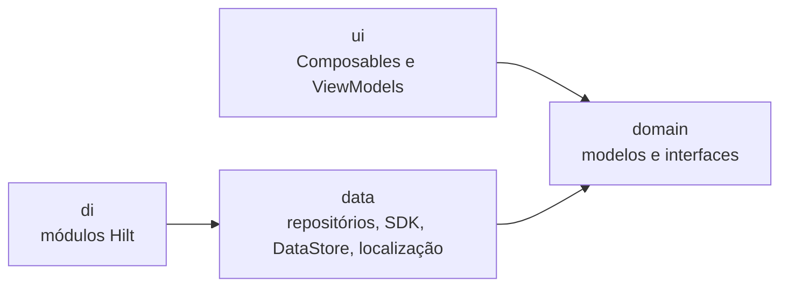
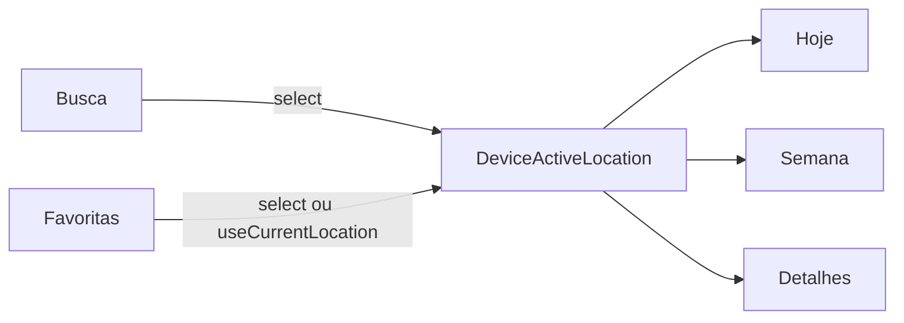

# Arquitetura

O WeatherFish tem um único módulo Gradle, o `:app`, por escolha do projeto. As camadas são pacotes dentro de `dev.rogerbertan.weatherfish`. Sem módulos separados, o compilador não impede que uma camada importe outra. O `ArchitectureTest` faz esse papel e falha quando uma camada importa um pacote que ela não pode usar.

## As camadas são pacotes

O diagrama mostra quem depende de quem:

- `domain` tem os modelos, como `Place`, `CurrentWeather` e `TemperatureUnit`. Também tem as interfaces `WeatherRepository`, `ActiveLocation` e `UserPreferences`. Não importa nada de Android.
- `data` implementa as interfaces. É o único pacote que importa o SDK Aeris, o Play Services e o DataStore.
- `ui` tem um pacote por tela e depende só de `domain`.
- `di` liga cada interface à implementação.

O repositório devolve os dados direto e lança uma `WeatherError` quando falha, como um service do Spring. O projeto não usa tipos de resultado como `Result`. A UI captura a `WeatherError` só no helper `loadState`. A tela então mostra a mensagem de erro e um botão para tentar de novo.

## Uma única cidade ativa para todas as telas

A `DeviceActiveLocation` é o único lugar que guarda a cidade ativa. Ela expõe a cidade como um flow, e os ViewModels de Hoje, Semana e Detalhes coletam esse flow. A Busca e as Favoritas só chamam `select`.

Nenhuma tela guarda uma cópia da cidade, então as três telas nunca mostram cidades diferentes. Quando a cidade muda, as três recarregam, mesmo as que não estão visíveis.

Na primeira coleta, a `DeviceActiveLocation` emite na hora a última cidade salva no DataStore, ou São Paulo se não houver nenhuma. Ao mesmo tempo, ela busca a localização do aparelho, e a Xweather converte essa localização em cidade. Quando a resposta chega, a cidade ativa passa a ser a local.

A busca de localização pode levar até 10 s de GPS, mais um request. Com a cidade salva emitida primeiro, a Hoje já mostra o clima durante esse tempo. Na barra do topo, ela mostra "Buscando sua localização". Se o usuário escolher outra cidade antes de a localização chegar, a `DeviceActiveLocation` cancela a busca.

O `select` e o `useCurrentLocation` rodam num escopo de aplicação, não no escopo do ViewModel. A tela de Favoritas volta para a Hoje logo depois de chamar `useCurrentLocation`. O Navigation então limpa o ViewModel das Favoritas, e o `viewModelScope` dele cancelaria a busca no meio.

## O cache guarda cada dado por um tempo diferente

O `CachingWeatherRepository` recebe as chamadas antes do repositório da Xweather. Ele guarda cada resposta pelo tempo desta tabela:

| Dado | Validade |
| --- | --- |
| Condição atual | 10 min |
| Previsão por hora | 30 min |
| Previsão diária | 1 h |

A Hoje e os Detalhes pedem a condição atual da mesma cidade. Quando os dois pedidos chegam ao mesmo tempo, o cache faz um único request e entrega a resposta para os dois. Esse request roda no escopo de aplicação. Se a Hoje cancelar a carga, a Detalhes continua esperando a mesma resposta. A busca de cidades não passa pelo cache.

## As preferências ficam num DataStore tipado

O DataStore guarda as favoritas, a última cidade e a unidade de temperatura no arquivo `settings.json`. O projeto usa o DataStore tipado porque as favoritas são uma lista de cidades, e o DataStore de chave e valor não guarda listas de objetos.

A API devolve a temperatura em Celsius, e a UI converte para Fahrenheit ao formatar. Trocar a unidade não faz request novo.

## Os dados falsos rodam o app sem chave

Os JSONs de `app/src/main/assets/fake/` imitam as respostas da Xweather, com um arquivo por endpoint. O `FakeWeatherRepository` lê esses arquivos quando a flag `DataSourceConfig.useFake` do `DataModule` está ligada. A latência e o erro simulado ficam no `FakeConfig`.

## Os testes rodam na JVM

Os testes unitários usam JUnit 5 e MockK e rodam sem emulador. Eles cobrem os ViewModels, o mapeamento das respostas da API, o cache, a cidade ativa e a leitura do DataStore. O `ArchitectureTest` usa Konsist para checar os imports entre as camadas.